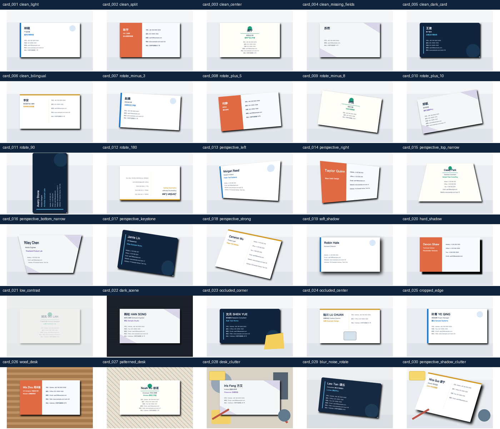

# CamCardReplica

CamCardReplica 是一个使用 SwiftUI 实现的本地名片管理 iOS App。它支持拍摄或从相册导入名片，在设备端完成边缘检测、透视校正、中文/英文 OCR 和字段解析，并提供人工核对、持久化、搜索、分组及系统联系人导出功能。

项目面向移动应用开发课程作业，使用自有品牌、合成素材和虚构测试数据复现完整名片管理流程；账号、会员、企业等非核心商业入口保留可交互的演示界面，不连接真实后端。

## 功能

- 相机拍摄与系统相册导入。
- Vision 名片边缘检测和 Core Image 透视校正。
- 原图与校正图双路径 OCR，根据信息完整度自动选择结果。
- 简体中文、英文及双语名片识别。
- 姓名、公司、职位、手机、座机、传真、邮箱、网站和地址解析。
- OCR 结果人工核对与修改，不对缺失字段进行生成式补全。
- SwiftData 本地持久化和原始名片图片文件存储。
- 名片列表、搜索、收藏、详情、编辑、备注和删除。
- 自定义分组、多分组成员关系及智能分组。
- 创建或更新系统联系人，避免重复导出。
- 开屏、登录、首页、名片夹、拍摄、核对、结果和详情等完整 SwiftUI 页面。

## 技术栈

| 模块 | 实现 |
|---|---|
| UI 与导航 | SwiftUI、Observation |
| 数据持久化 | SwiftData、Application Support 图片文件 |
| OCR | Vision `VNRecognizeTextRequest` |
| 边缘检测 | Vision `VNDetectRectanglesRequest` |
| 透视校正 | Core Image `CIPerspectiveCorrection` |
| 相机 | AVFoundation |
| 相册 | PhotosUI `PhotosPicker` |
| 系统联系人 | Contacts |
| 测试 | XCTest、XCUITest、30 张合成名片 Ground Truth 数据集 |

所有识别和数据存储均在设备本地完成，项目不依赖第三方库或网络服务。

## 环境要求

- macOS 与 Xcode 26.4 或兼容版本。
- iOS 26.4 SDK。
- 推荐测试设备：iPhone 17 Pro，iOS 26.4。
- 真机使用相机时需要允许相机权限；导出联系人时需要允许通讯录权限。

Deployment Target 为 iOS 26.4，Bundle Identifier 为 `shinn.CamCardReplica`。

## 快速开始

1. 使用 Xcode 打开 `CamCardReplica.xcodeproj`。
2. 选择 `CamCardReplica` Scheme。
3. 选择一台 iOS 26.4 模拟器或真机。
4. 点击 Run，启动后勾选用户协议并进入本地演示登录流程。

命令行构建：

```bash
xcodebuild \
  -project CamCardReplica.xcodeproj \
  -scheme CamCardReplica \
  -destination 'generic/platform=iOS Simulator' \
  build
```

模拟器没有实体摄像头，应从拍摄页左下角选择相册图片进行测试。真机可使用完整拍摄、边缘检测和透视校正流程。

## 使用流程

```text
开屏 → 本地演示登录 → 首页/名片夹
                         ↓
                 拍照或相册导入
                         ↓
              边缘检测与透视校正
                         ↓
                    本地 OCR
                         ↓
                 人工核对并保存
                         ↓
        搜索 / 详情 / 编辑 / 分组 / 通讯录导出
```

首次使用可将 `TestData/BusinessCardDataset/images` 中的图片拖入模拟器相册，再从 App 的相册入口选择图片。

## 测试

串行运行全部单元测试，避免 Xcode 同时创建多个模拟器 Clone：

```bash
xcodebuild \
  -project CamCardReplica.xcodeproj \
  -scheme CamCardReplica \
  -destination 'platform=iOS Simulator,OS=26.4,name=iPhone 17 Pro' \
  -parallel-testing-enabled NO \
  -only-testing:CamCardReplicaTests \
  test
```

最近一次串行验证结果为 27/27 通过。

### 30 张名片基准

`TestData/BusinessCardDataset` 包含 30 张确定性合成名片，覆盖：

- 中文、英文和双语排版。
- 旋转、透视、阴影、遮挡、裁边、模糊、噪声和复杂背景。
- 缺失字段及手机、座机、传真分类。
- JSON、CSV Ground Truth、原始 SVG、联系表和 SHA-256 校验值。

运行基准：

```bash
xcodebuild \
  -project CamCardReplica.xcodeproj \
  -scheme CamCardReplica \
  -destination 'platform=iOS Simulator,OS=26.4,name=iPhone 17 Pro' \
  -parallel-testing-enabled NO \
  -only-testing:CamCardReplicaTests/BusinessCardDatasetTests/testThirtyCardDatasetOCRBenchmark \
  test
```

当前固定数据集结果：

| 指标 | 结果 |
|---|---:|
| 完成处理 | 30 / 30 |
| OCR Ground Truth 值召回 | 224 / 224（100%） |
| 非空字段解析准确率 | 224 / 224（100%） |
| 全字段准确率 | 270 / 270（100%） |
| 平均耗时 | 约 2.120 秒/张 |

详细报告见 [ProjectDocs/BusinessCardDatasetBenchmark.md](ProjectDocs/BusinessCardDatasetBenchmark.md)。100% 仅代表这套固定合成数据，不等同于真实世界泛化准确率。



## 项目结构

```text
CamCardReplica/
├── App/                 App 入口、导航和主标签栏
├── DesignSystem/        颜色、间距和复用组件
├── Features/            首页、名片夹、拍摄、核对、详情和分组页面
├── Models/              名片、分组和草稿模型
├── Persistence/         SwiftData 事务与关系维护
├── Services/            OCR、相机、校正、图片存储和联系人导出
└── Fixtures/            只读演示数据
CamCardReplicaTests/     单元测试与数据集基准
CamCardReplicaUITests/   UI 自动化测试
TestData/                合成名片及 Ground Truth
ProjectDocs/             各阶段实现与验证记录
Tools/                   测试集生成脚本
Artifacts/               Release 构建产物与校验信息
```

## 构建产物

仓库中的 [Artifacts/CamCardReplica-1.0-iOS-Simulator.zip](Artifacts/CamCardReplica-1.0-iOS-Simulator.zip) 是 Release 配置的 iOS 26.4 模拟器构建。解压后得到 `CamCardReplica.app`，可通过以下命令安装到已经启动的模拟器：

```bash
xcrun simctl install booted CamCardReplica.app
xcrun simctl launch booted shinn.CamCardReplica
```

该产物不能安装到真机。真机安装需要使用开发者账号在 Xcode 中完成签名并重新 Archive。

## 数据和隐私

- 测试集中的姓名、公司、电话和地址均为虚构信息。
- 测试邮箱统一使用保留域名 `example.com`。
- OCR、图片和名片数据默认只保存在本地。
- App 不会将名片上传到服务器。
- 只有用户主动导出时，确认后的字段才会写入系统通讯录。

## 已知限制

- 模拟器不能测试真实相机硬件、自动闪光和实际拍摄质量。
- 当前每种电话和邮箱类型只保存一个值。
- 账号、会员、企业、社交分享和提醒属于演示入口，不连接线上服务。

## 文档

- [相机与透视校正](ProjectDocs/Stage5CameraAndCorrection.md)
- [分组功能](ProjectDocs/Stage5Grouping.md)
- [系统联系人导出](ProjectDocs/Stage5SystemContacts.md)
- [OCR 基准报告](ProjectDocs/BusinessCardDatasetBenchmark.md)

## License

本项目用于课程学习和演示。第三方商业产品名称仅用于描述参考目标，不代表关联、授权或背书。
